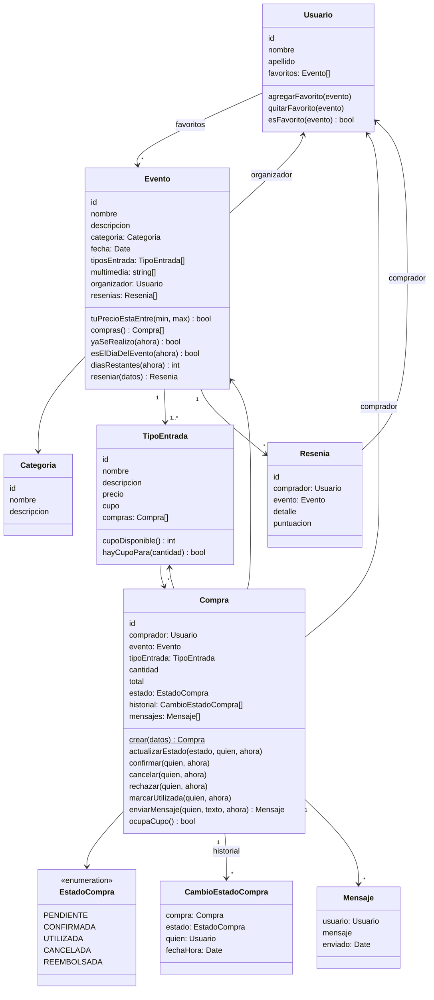
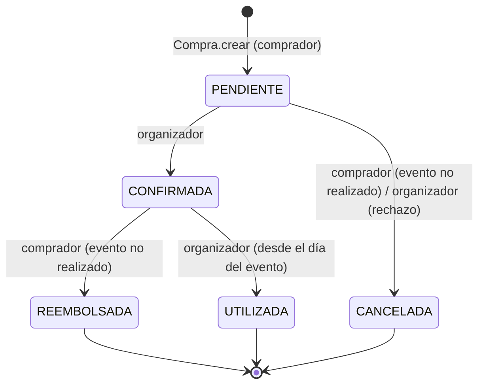

# Data Model: Modelo de dominio de AI Ticket It

**Feature**: `001-modelo-dominio` · **Fecha**: 2026-11-18

Todas las clases viven en `backend/src/domain/`. Todas reciben un `id` (ver
research D9), y las que dependen del tiempo reciben `ahora` (D6).

## Diagrama (tal como queda implementado)

## Entidades

### Usuario (`usuario.js`)

| Campo | Regla |
|---|---|
| `id` | string no vacío |
| `nombre`, `apellido` | string no vacío (sin contar espacios) |
| `favoritos` | lista de solo lectura, sin duplicados (por `id`) |

- `agregarFavorito(evento)`: si ya está, no hace nada (FR-026).
- `quitarFavorito(evento)`: si no está, no hace nada.
- `esFavorito(evento)`: dice si el evento está en favoritos.

### Categoria (`categoria.js`)

| Campo | Regla |
|---|---|
| `id` | string no vacío |
| `nombre`, `descripcion` | string no vacío |

La unicidad del nombre (FR-027) se valida donde vive la colección, es decir,
en el repositorio de la feature siguiente. Esta feature exporta
`normalizarNombre(nombre)` para comparar sin distinguir mayúsculas ni
espacios.

### TipoEntrada (`tipoEntrada.js`)

| Campo | Regla |
|---|---|
| `id` | string no vacío |
| `nombre`, `descripcion` | `nombre` no vacío; `descripcion` puede estar vacía |
| `precio` | número finito ≥ 0 (FR-002) |
| `cupo` | entero > 0 (FR-002) |
| `compras` | las registra `Compra.crear`; lista de solo lectura |

- `cupoDisponible()` = `cupo − Σ cantidad` de las compras que ocupan cupo
  (FR-005, research D5).
- `hayCupoPara(cantidad)` = `cantidad ≤ cupoDisponible()` (FR-004).

### Evento (`evento.js`)

| Campo | Regla |
|---|---|
| `id` | string no vacío |
| `nombre`, `descripcion` | no vacíos |
| `categoria` | instancia de `Categoria` |
| `fecha` | `Date` válida: fecha y hora de inicio (FR-001) |
| `tiposEntrada` | ≥ 1, cada uno un `TipoEntrada`, sin nombres repetidos (FR-001, FR-002) |
| `multimedia` | lista de strings (URLs); puede estar vacía |
| `organizador` | instancia de `Usuario` |
| `resenias` | las agrega `reseniar`; lista de solo lectura |

- `tuPrecioEstaEntre(min, max)`: verdadero si algún tipo tiene un precio en
  `[min, max]`. Si `min > max`, es falso (FR-003).
- `compras()`: todas las compras de todos sus tipos de entrada.
- `yaSeRealizo(ahora)`: `ahora ≥ fecha` (Assumptions de la spec).
- `esElDiaDelEvento(ahora)`: el día calendario en Buenos Aires de `ahora` es
  igual o posterior al de `fecha` (FR-015).
- `diasRestantes(ahora)`: días calendario en Buenos Aires de `ahora` a
  `fecha` (FR-018). Es 0 el mismo día y negativo si ya pasó.
- `reseniar({ id, comprador, puntuacion, detalle })` (FR-019 a FR-021):
  - Lanza `ErrorPermiso` si el comprador no tiene ninguna compra `UTILIZADA`
    de este evento.
  - Lanza `ErrorConflicto` si ya existe una reseña suya.
  - Lanza `ErrorValidacion` si `puntuacion` no es un entero de 1 a 5.
  - Si todo es válido, crea la `Resenia`, la agrega y la devuelve.

### Compra (`compra.js`)

| Campo | Regla |
|---|---|
| `id` | string no vacío |
| `comprador` | `Usuario` |
| `evento`, `tipoEntrada` | el tipo DEBE pertenecer al evento |
| `cantidad` | entero ≥ 1 (FR-007) |
| `total` | `precio × cantidad` al crear; nunca se recibe (FR-008) |
| `estado` | privado; solo lectura (research D3) |
| `historial` | privado; lista de solo lectura de `CambioEstadoCompra` |
| `mensajes` | lista de solo lectura de `Mensaje` |

- `Compra.crear({ id, comprador, evento, tipoEntrada, cantidad, ahora })`
  (FR-006 a FR-009):
  1. Valida los datos y que el tipo pertenezca al evento (`ErrorValidacion`).
  2. Si no hay cupo, lanza `ErrorConflicto`.
  3. Crea la compra en `PENDIENTE`, con un primer registro de historial a
     nombre del comprador.
  4. La registra en `tipoEntrada.compras`.
- `actualizarEstado(nuevoEstado, quien, ahora)` es el **único** punto de cambio
  (FR-010, FR-011, FR-016b). Ver la máquina de estados más abajo.
- Los atajos solo eligen el destino y delegan en `actualizarEstado`:

  | Atajo | Destino |
  |---|---|
  | `confirmar` | `CONFIRMADA` |
  | `rechazar` | `CANCELADA` |
  | `marcarUtilizada` | `UTILIZADA` |
  | `cancelar` | `CANCELADA` si está `PENDIENTE`; `REEMBOLSADA` si está `CONFIRMADA` (FR-014) |

  Si `cancelar` se llama en un estado final, delega igual y la tabla lo
  rechaza.
- `enviarMensaje(quien, texto, ahora)` (FR-023, FR-024):
  - Lanza `ErrorPermiso` si `quien` no es el comprador ni el organizador.
  - Lanza `ErrorValidacion` si el texto está vacío o tiene solo espacios.
  - Si todo es válido, agrega el `Mensaje` y lo devuelve.
- `ocupaCupo()`: el estado es `PENDIENTE`, `CONFIRMADA` o `UTILIZADA`.

### CambioEstadoCompra (`cambioEstadoCompra.js`)

Es un valor inmutable (`Object.freeze`) con `{ compra, estado, quien,
fechaHora }`. Solo lo crea `Compra`.

### Mensaje (`mensaje.js`)

Es un valor inmutable con `{ usuario, mensaje, enviado }`. El texto se guarda
recortado (`trim`).

### Resenia (`resenia.js`)

Es inmutable, con `{ id, comprador, evento, detalle, puntuacion }`.
`detalle` puede estar vacío y `puntuacion` es un entero de 1 a 5. Solo la crea
`Evento.reseniar`.

## Máquina de estados de Compra (`estadoCompra.js`)

`TRANSICIONES` (congelada) replica FR-016b:

| desde | hacia | rol | condicion(compra, ahora) |
|---|---|---|---|
| PENDIENTE | CONFIRMADA | organizador | — |
| PENDIENTE | CANCELADA | comprador | `!evento.yaSeRealizo(ahora)` |
| PENDIENTE | CANCELADA | organizador | — |
| CONFIRMADA | REEMBOLSADA | comprador | `!evento.yaSeRealizo(ahora)` |
| CONFIRMADA | UTILIZADA | organizador | `evento.esElDiaDelEvento(ahora)` |

Algoritmo de `actualizarEstado(nuevoEstado, quien, ahora)` (research D4):

1. `nuevoEstado` no es un `EstadoCompra` válido → `ErrorValidacion`.
2. No hay filas para `estado → nuevoEstado` → `ErrorConflicto` ("no se
   puede pasar de X a Y").
3. Ninguna fila coincide con los roles de `quien` → `ErrorPermiso`.
4. Ninguna fila de esos roles cumple su condición → `ErrorConflicto` con el
   motivo (por ejemplo, "el evento ya se realizó" o "todavía no es el día del
   evento").
5. Si pasa todo, cambia el estado y agrega un `CambioEstadoCompra(estado,
   quien, ahora)`.

Los roles de `quien` son `comprador` si `quien.id === compra.comprador.id` y
`organizador` si `quien.id === compra.evento.organizador.id`. Puede tener los
dos (edge case de la spec).

## Funciones puras

- **`fechas.js`**:
  - `diaCalendario(fecha)`: devuelve `'YYYY-MM-DD'` en
    `America/Argentina/Buenos_Aires`.
  - `diasEntre(desde, hasta)`: diferencia en días calendario de Buenos Aires.
- **`reputacion.js`**: `puntajeOrganizador(eventos)` devuelve el promedio de
  las puntuaciones de las reseñas de esos eventos, o `null` si no hay
  ninguna (FR-022). Quien la llama le pasa los eventos de un organizador.
- **`errores.js`**: `ErrorDeDominio`, `ErrorValidacion`, `ErrorPermiso` y
  `ErrorConflicto` (research D8).

## Desvíos respecto del diagrama del enunciado

La constitución pide justificarlos:

| Desvío | Motivo |
|---|---|
| `id` en todas las entidades | Identidad estable para comparar y para los repositorios (D9). |
| `TipoEntrada.compras` | Permite calcular el cupo disponible sin un contador que se desincronice (D5). |
| `Compra.historial` (además de `CambioEstadoCompra.compra`) | La compra es dueña de su historial; así el historial no se puede saltear (D3). |
| `actualizarEstado(estado, quien, ahora)` | El diagrama solo recibe el estado, pero el historial necesita quién y cuándo (FR-011), y las condiciones necesitan la hora. |
| `Evento.resenias` y `Evento.reseniar` | El evento ya conoce sus compras, así que es quien puede verificar "una reseña por comprador con compra utilizada". |
| `puntuacion` entera de 1 a 5 (el diagrama dice `Double`) | Spec FR-021 y sus Assumptions. |
